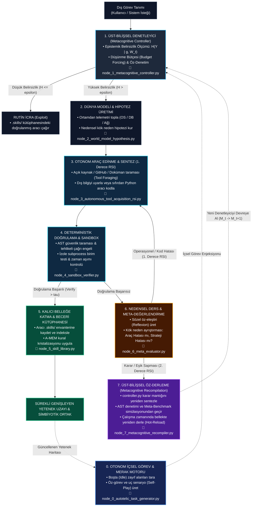

# SENTINEL — Kısıtlı Donanımlarda Öz-Yinelemeli ve Simbiyotik AGI Bilişsel Mimarisi
### **S**elf-**E**volving **N**etworked **T**hought & **IN**ference **E**ngine for **L**ocal AGI
*(Yerel Genel Yapay Zeka için Öz-Evrimleşen Ağsal Düşünce ve Çıkarım Motoru)*


-0f766e?style=flat-square)


> - **Canlı İnteraktif Portal (GitHub Pages):** **[https://emreusun87.github.io/sentinel/docs/](https://emreusun87.github.io/sentinel/docs/)**
> - **Tam Ekran İnteraktif Mimari Diyagram:** **[https://emreusun87.github.io/sentinel/docs/diagram.html](https://emreusun87.github.io/sentinel/docs/diagram.html)**

**SENTINEL** (*Self-Evolving Networked Thought & INference Engine for Local AGI*), harici GPU kümelerine ve bulut API'lerine bağımlı kalmadan standart **x86 CPU ve 16 GB RAM** üzerinde çalışmak üzere tasarlanmış; **kuantize küçük dil modellerini (2B–7B SLM)** içsel merak motoru, açık kaynak araç keşfi (*Tool Foraging*), deterministik sandbox doğrulaması ve **üst-bilişsel öz-derleme (2. Derece RSI)** ile birleştiren yerel ve simbiyotik bir AGI bilişsel mimari spesifikasyonudur.

---

## İnteraktif Redoc Dokümantasyon Portalı (`docs/index.html`)

Bu depo, hiçbir derleme aracı (Node.js/Webpack vb.) gerektirmeyen **Sıfır-Derleme (Zero-Build) 3-Sütunlu Redoc Portalı** içerir:

- **Sol Panel:** Mimari çekirdek, bilişsel düğümler (`Node 0`–`Node 7`) ve 5 tematik başlık altında gruplanmış 20 çalışma notu + anlık arama (`/`).
- **Orta Panel:** Tıklanabilir interaktif **Mermaid** bilişsel karar diyagramı, **KaTeX** matematiksel formüller, felsefi sütunlar ve makale analizleri.
- **Sağ Panel (Senkronize Koyu Kod & Atıf Paneli):** Seçili düğümün gerçek Python referans kodu (`src/nodes/`), tek tıkla kod/Mermaid kopyalama ve ilgili makalelerin yerel PDF + arXiv kartları.

### Hızlı Çalıştırma
```powershell
# Seçenek 1: Doğrudan tarayıcıda aç (file:// protokolünde CORS hatası olmadan çalışır)
Start-Process .\docs\index.html

# Seçenek 2: Yerel HTTP sunucusu üzerinden çalıştır
python -m http.server 8080
# Tarayıcı: http://localhost:8080/docs/
```

> **GitHub Pages Yayını:** GitHub depo ayarlarından **Settings ➔ Pages ➔ Build and deployment** altında `Deploy from a branch` seçip `main` dalını `/ (root)` (PDF erişimi dahil: `https://<kullanici>.github.io/<repo>/docs/`) veya `/docs` olarak işaretleyerek doğrudan yayınlayabilirsiniz.

---

## Bilişsel Karar, İçsel Merak ve Çift Katmanlı RSI Döngüsü



---

## Depo Klasör Yapısı

```text
sentinel/
├── README.md                              # Ana depo vitrini, diyagram ve indeks matrisleri
├── docs/                                  # GitHub Pages kökü ve teknik dokümantasyon
│   ├── index.html                         # 3-sütunlu Redoc stili interaktif Ar-Ge portalı
│   ├── architecture.md                    # Tam kapsamlı mimari, matematiksel ve felsefi spesifikasyon
│   ├── assets/                            # Portal CSS, JS ve otomatik üretilen veri paketi
│   └── notes/                             # #01..#20 çapraz bağlantılı Markdown Ar-Ge çalışma notları
├── papers/                                # İndirilen 19 orijinal akademik makale (PDF)
├── src/
│   └── nodes/                             # Node 0 .. Node 7 AST doğrulanmış Python referans modülleri
└── scripts/
    ├── build_portal_index.py              # Notları ve Python modüllerini Redoc portalına senkronize eder
    └── download_all.py                    # Akademik PDF arşivini papers/ dizinine indirir / doğrular
```

---

## 1. Bilişsel Düğümler ve Referans Python Modülleri

Tam mimari ve formel matematiksel açıklamalar için: **[`docs/architecture.md`](docs/architecture.md)**

| Düğüm | Mermaid ID | Python Modülü | Sorumluluk | İlgili Çalışma Notları |
| :--- | :--- | :--- | :--- | :--- |
| **Node 0** | `AutotelicEngine` | [`src/nodes/node_0_autotelic_task_generator.py`](src/nodes/node_0_autotelic_task_generator.py) | Boşta (idle) durumda zayıf güven alanlarını tarayıp içsel merak görevleri üretir | `#02`, `#10`, `#15`, `#19` |
| **Node 1** | `MetaCtrl` | [`src/nodes/node_1_metacognitive_controller.py`](src/nodes/node_1_metacognitive_controller.py) | Shannon entropisi ($H$) ile epistemik belirsizliği ölçer, düşünme bütçesini yönetir | `#03`, `#05`, `#06`, `#09`, `#12`, `#14`, `#17`, `#20` |
| **Node 2** | `WorldModel` | [`src/nodes/node_2_world_model_hypothesis.py`](src/nodes/node_2_world_model_hypothesis.py) | Çevresel telemetriyi toplar ve nedensel kök neden hipotezi üretir | `#04`, `#06`, `#13`, `#14`, `#18` |
| **Node 3** | `ToolAcquisitionRSI` | [`src/nodes/node_3_autonomous_tool_acquisition_rsi.py`](src/nodes/node_3_autonomous_tool_acquisition_rsi.py) | GitHub/Web/doküman taraması (Tool Foraging) ve Python araç sentezi (1. Derece RSI) | `#07`, `#08`, `#10`, `#15`, `#19` |
| **Node 4** | `SandboxVerify` | [`src/nodes/node_4_sandbox_verifier.py`](src/nodes/node_4_sandbox_verifier.py) | AST güvenlik taraması, tehlikeli çağrı engeli ve izole subprocess doğrulaması | `#01`, `#02`, `#09`, `#11`, `#20` |
| **Node 5** | `SkillLib` | [`src/nodes/node_5_skill_library.py`](src/nodes/node_5_skill_library.py) | Doğrulanan araçları `.skills/` envanterine katar ve kuralları kristalize eder | `#04`, `#13`, `#14`, `#15`, `#18` |
| **Node 6** | `MetaEval` | [`src/nodes/node_6_meta_evaluator.py`](src/nodes/node_6_meta_evaluator.py) | Sözel öz-eleştiri üretir; hatayı Araç (RSI-L1) veya Strateji (RSI-L2) olarak ayrıştırır | `#01`, `#07`, `#11`, `#16` |
| **Node 7** | `Recompile` | [`src/nodes/node_7_metacognitive_recompiler.py`](src/nodes/node_7_metacognitive_recompiler.py) | `controller.py` karar mantığını yeniden yazar, Meta-Benchmark'ta sınar ve `reload` eder | `#01`, `#07`, `#08`, `#20` |

---

## 2. Akademik Literatür ve Ar-Ge Çalışma Notları (`#01` – `#20`)

### I. Öz-Yinelemeli Gelişim (RSI) ve Ajan Evrimi
| # | Çalışma / Konu | Çalışma Notu (`.md`) | Yerel PDF | SENTINEL Rolü |
| :--- | :--- | :--- | :--- | :--- |
| **01** | Darwin Gödel Machine (DGM) | [`01_Darwin_Godel_Machine.md`](docs/notes/01_Darwin_Godel_Machine.md) | [`PDF`](papers/01_Darwin_Godel_Machine.pdf) | Kendi orkestrasyon kodunu mutate edip ampirik testle doğrulayan evrimsel döngü |
| **02** | Absolute Zero | [`02_Absolute_Zero.md`](docs/notes/02_Absolute_Zero.md) | [`PDF`](papers/02_Absolute_Zero.pdf) | Sıfır veriyle kendi kendine senaryo kurup çözerek akıl yürütme (self-play) |
| **07** | Gödel Agent | [`07_Godel_Agent.md`](docs/notes/07_Godel_Agent.md) | [`PDF`](papers/07_Godel_Agent.pdf) | Çalışma zamanında yeni araç ve denetleyici modüllerini dinamik derleme |
| **08** | ADAS | [`08_ADAS_Automated_Design_Agentic_Systems.md`](docs/notes/08_ADAS_Automated_Design_Agentic_Systems.md) | [`PDF`](papers/08_ADAS_Automated_Design_Agentic_Systems.pdf) | Problemin yapısına göre dinamik alt-ajan topolojileri ve DAG kodlama |
| **10** | Open-Endedness in AI (DeepMind) | [`10_Open_Endedness_DeepMind.md`](docs/notes/10_Open_Endedness_DeepMind.md) | [`PDF`](papers/10_Open_Endedness_DeepMind.pdf) | Ucu açık görev üretimi ve sürekli genişleyen beceri uzayı |
| **15** | Voyager | [`15_Voyager_Open_Ended_Agent.md`](docs/notes/15_Voyager_Open_Ended_Agent.md) | [`PDF`](papers/15_Voyager_Open_Ended_Agent.pdf) | Merak müfredatı ve doğrulanmış Python betiklerini `.skills/` kütüphanesine katma |

### II. Test Anı Akıl Yürütme (Test-Time Compute) ve Öz-Değerlendirme
| # | Çalışma / Konu | Çalışma Notu (`.md`) | Yerel PDF | SENTINEL Rolü |
| :--- | :--- | :--- | :--- | :--- |
| **05** | s1: Simple Test-Time Scaling | [`05_s1_Simple_Test_Time_Scaling.md`](docs/notes/05_s1_Simple_Test_Time_Scaling.md) | [`PDF`](papers/05_s1_Simple_Test_Time_Scaling.pdf) | `Budget forcing` ile küçük modelin analiz derinliğini çıkarım anında artırma |
| **06** | DeepSeek-R1 | [`06_DeepSeek_R1_Reasoning.md`](docs/notes/06_DeepSeek_R1_Reasoning.md) | [`PDF`](papers/06_DeepSeek_R1_Reasoning.pdf) | `<think>` iç monoloğu, öz-düzeltme ve damıtılmış SLM çekirdeği |
| **09** | Scaling LLM Test-Time Compute | [`09_Scaling_LLM_Test_Time_Compute.md`](docs/notes/09_Scaling_LLM_Test_Time_Compute.md) | [`PDF`](papers/09_Scaling_LLM_Test_Time_Compute.pdf) | Aday çözüm planlarını üretip doğrulayıcı ile seçme (Best-of-N) |
| **11** | Self-Rewarding Language Models | [`11_Self_Rewarding_Language_Models.md`](docs/notes/11_Self_Rewarding_Language_Models.md) | [`PDF`](papers/11_Self_Rewarding_Language_Models.pdf) | Üretilen sistem müdahale planlarının güvenlik rubrikleriyle öz-puanlaması |
| **16** | Reflexion | [`16_Reflexion_Verbal_Reinforcement.md`](docs/notes/16_Reflexion_Verbal_Reinforcement.md) | [`PDF`](papers/16_Reflexion_Verbal_Reinforcement.pdf) | Ağırlık güncellemesiz sözel öz-eleştiri ve hata kök neden belleği |
| **18** | STaR: Bootstrapping Reasoning | [`18_STaR_Bootstrapping_Reasoning.md`](docs/notes/18_STaR_Bootstrapping_Reasoning.md) | [`PDF`](papers/18_STaR_Bootstrapping_Reasoning.pdf) | Doğrulanmış başarılı akıl yürütme izlerini (*gold traces*) arşivleme |

### III. Kısıtlı Donanım, Kuantizasyon ve SLM Motoru
| # | Çalışma / Konu | Çalışma Notu (`.md`) | Yerel PDF | SENTINEL Rolü |
| :--- | :--- | :--- | :--- | :--- |
| **03** | BitNet b1.58 2B4T | [`03_BitNet_b1_58_2B4T.md`](docs/notes/03_BitNet_b1_58_2B4T.md) | [`PDF`](papers/03_BitNet_b1_58_2B4T.pdf) | `{-1, 0, 1}` ağırlıklarla CPU'da tam sayı toplama tabanlı hızlı çıkarım |
| **12** | AWQ (4-bit Activation-aware) | [`12_AWQ_Activation_aware_Weight_Quantization.md`](docs/notes/12_AWQ_Activation_aware_Weight_Quantization.md) | [`PDF`](papers/12_AWQ_Activation_aware_Weight_Quantization.pdf) | %1 kritik ağırlık korumasıyla 7B–8B modeli ~4.5 GB RAM sınırına indirme |
| **17** | LLM.int8() | [`17_LLM_int8_Matrix_Multiplication.md`](docs/notes/17_LLM_int8_Matrix_Multiplication.md) | [`PDF`](papers/17_LLM_int8_Matrix_Multiplication.pdf) | Aykırı aktivasyon izolasyonu ile düşük bitli CPU çıkarımında sayısal kararlılık |

### IV. Bilişsel Mimari ve Bellek Hiyerarşisi
| # | Çalışma / Konu | Çalışma Notu (`.md`) | Yerel PDF | SENTINEL Rolü |
| :--- | :--- | :--- | :--- | :--- |
| **04** | A-MEM: Agentic Memory | [`04_A_MEM_Agentic_Memory.md`](docs/notes/04_A_MEM_Agentic_Memory.md) | [`PDF`](papers/04_A_MEM_Agentic_Memory.pdf) | Ham telemetriyi tek cümlelik kalıcı kurallara kristalize eden aktif bellek |
| **13** | MemGPT (LLMs as OS) | [`13_MemGPT_LLM_OS.md`](docs/notes/13_MemGPT_LLM_OS.md) | [`PDF`](papers/13_MemGPT_LLM_OS.pdf) | 4K aktif bağlam penceresi + SQLite disk sayfalama (*page-in/out*) |
| **14** | CoALA | [`14_CoALA_Cognitive_Architectures.md`](docs/notes/14_CoALA_Cognitive_Architectures.md) | [`PDF`](papers/14_CoALA_Cognitive_Architectures.pdf) | Çalışan, Epizodik, Anlamsal ve Prosedürel 4 katmanlı bilişsel iskelet |

### V. Zeka Ölçümü, Felsefe ve İnsan-YZ Simbiyozu
| # | Çalışma / Konu | Çalışma Notu (`.md`) | Yerel PDF | SENTINEL Rolü |
| :--- | :--- | :--- | :--- | :--- |
| **19** | On the Measure of Intelligence (Chollet) | [`19_On_the_Measure_of_Intelligence_Chollet.md`](docs/notes/19_On_the_Measure_of_Intelligence_Chollet.md) | [`PDF`](papers/19_On_the_Measure_of_Intelligence_Chollet.pdf) | Birim CPU ve model boyutu başına yeni beceri edinme verimliliği metriği |
| **20** | Human-AI Symbiosis & Centaur Intelligence | [`20_Human_AI_Symbiosis_ve_Sentor_Zekasi.md`](docs/notes/20_Human_AI_Symbiosis_ve_Sentor_Zekasi.md) | *(Teorik Çerçeve)* | Licklider & Engelbart ekseninde bilişsel iskele (*exocortex*), hizalama ve egemen zeka |

---

## Portal Veri Senkronizasyonu ve Bakım Komutları

`docs/notes/*.md` altındaki çalışma notlarını veya `src/nodes/*.py` modüllerini güncellediğinizde Redoc portalının veri indeksini yenilemek için:

```powershell
python .\scripts\build_portal_index.py
```

Eksik PDF makalelerini doğrulamak veya yeniden indirmek için:

```powershell
python .\scripts\download_all.py
```
