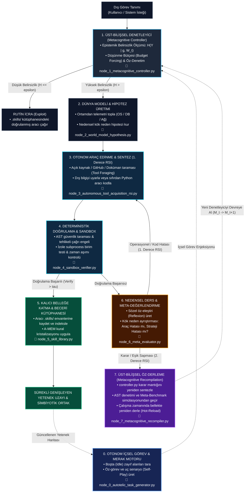

# SENTINEL: Kısıtlı Donanımlarda Öz-Yinelemeli ve Simbiyotik AGI Bilişsel Mimarisi

**Proje Kodu:** SENTINEL  
**Açılımı:** **S**elf-**E**volving **N**etworked **T**hought & **IN**ference **E**ngine for **L**ocal AGI *(Yerel Genel Yapay Zeka için Öz-Evrimleşen Ağsal Düşünce ve Çıkarım Motoru)*  
**Hedef Ortam:** Kısıtlı donanım kaynakları (Harici GPU bulunmayan, standart x86 CPU ve 16 GB RAM mimarisi)  
**Çalışma Prensibi:** Yerel egemen zeka (Sovereign / Air-Gapped opsiyonlu), veri mahremiyeti odaklı, çift katmanlı RSI  

---

## 1. Çıkış Noktası ve Problem Tanımı

Mevcut büyük dil modelleri (LLM) trilyon parametreli mimarilere ve merkezi GPU kümelerine bağımlı olarak ölçekleniyor. Bu yaklaşımın mühendislik ve bilişsel mimari açısından üç temel açmazı bulunuyor:

1. **Veri Mahremiyeti ve Merkeziyetçi Bağımlılık:** Hassas kurumsal sistem kütüklerini, veritabanı şemalarını veya sunucu telemetrisini harici bulut API'lerine göndermek güvenlik açısından kabul edilemez.
2. **Statik Ezber vs. Dinamik Akıl Yürütme:** Sabit ağırlıklarla eğitilmiş modeller, eğitim dağılımının dışındaki (out-of-distribution) yeni bir sistem arızası veya bilinmeyen bir protokol ile karşılaştığında gerçek nedensel problem çözümü üretemez; istatistiksel tamamlama yoluyla halüsinasyona düşer.
3. **Pasif Araçsal Tekdüzelik:** Geleneksel ajan yapıları yalnızca dışarıdan komut geldiğinde tetiklenir ve elindeki sabit araç setiyle sınırlı kalır; boşta (idle) kaldığı zaman dilimlerinde kendi kör noktalarını kapatamaz veya karar mekanizmasını revize edemez.

**SENTINEL** projesinin amacı; yalnızca CPU üzerinde çalışabilen 2B–7B parametre aralığındaki kuantize küçük modelleri ($M_{\text{core}}$) temel akıl yürütme çekirdeği olarak konumlandırmak; bu çekirdeğin etrafına **otonom içsel merak motoru**, **üst-bilişsel öz-denetim**, **açık kaynak araç keşfi + kod sentezi (1. Derece RSI)**, **üst-bilişsel öz-derleme (2. Derece RSI)** ve **çok katmanlı bellek hiyerarşisi** inşa ederek kısıtlı donanımda ucu açık (open-ended) bir genel zeka davranışı elde etmektir.

---

## 2. Temel Mimari Hipotez

> **Hipotez:**  
> Genel Yapay Zeka (AGI), milyarlarca parametrenin statik ağırlıklarında değil; kısıtlı ve kuantize bir çekirdeğin ($M_{\text{core}}$), hem dış görevlerde hem de kendi ürettiği içsel merak görevlerinde epistemik belirsizliğini ölçebildiği, eksik araçları dış kaynaklardan keşfedip çalışma zamanında (runtime) sentezleyebildiği, doğrulanmış becerileri kalıcı belleğine katabildiği ve gerektiğinde bizzat kendi üst-bilişsel karar kodunu yeniden derleyebildiği bilişsel bir mimariden doğar.

---

## 3. SENTINEL Bilişsel Karar, Merak ve Çift Katmanlı RSI Döngüsü

Sistem; dışarıdan gelen görevlerin yanı sıra boşta kaldığında kendi kendine görev üretebilen (`AutotelicEngine`), eksik araçları GitHub/Web/dokümantasyon üzerinden araştırıp kodlayabilen (`ToolAcquisitionRSI`) ve karar stratejisi yetersiz kaldığında kendi denetleyicisini (`controller.py`) çalışma zamanında yeniden derleyebilen (`Recompile`) kapalı çevrim bir bilişsel mimari üzerinde çalışır:

### Mimari Düğümler ve Referans Kod Eşleşmesi

| Düğüm | Mermaid ID | Python Referans Modülü | Görevi ve Temel Mekanizması | Temel Akademik Atıflar |
| :--- | :--- | :--- | :--- | :--- |
| **Node 0** | `AutotelicEngine` | [`src/nodes/node_0_autotelic_task_generator.py`](../src/nodes/node_0_autotelic_task_generator.py) | Boşta (idle) durumda zayıf güven bölgelerini tarayıp içsel merak görevleri üretir. | `#02` Absolute Zero, `#10` Open-Endedness, `#15` Voyager |
| **Node 1** | `MetaCtrl` | [`src/nodes/node_1_metacognitive_controller.py`](../src/nodes/node_1_metacognitive_controller.py) | Epistemik belirsizliği ($H$) ölçer, düşünme bütçesini tahsis eder ve Rutin/Keşif ayrımını yapar. | `#03` BitNet, `#05` s1, `#06` DeepSeek-R1, `#09` TTC, `#14` CoALA |
| **Node 2** | `WorldModel` | [`src/nodes/node_2_world_model_hypothesis.py`](../src/nodes/node_2_world_model_hypothesis.py) | Sistem telemetrisini toplar ve test edilebilir nedensel kök neden hipotezi kurar. | `#04` A-MEM, `#13` MemGPT, `#14` CoALA, `#18` STaR |
| **Node 3** | `ToolAcquisitionRSI` | [`src/nodes/node_3_autonomous_tool_acquisition_rsi.py`](../src/nodes/node_3_autonomous_tool_acquisition_rsi.py) | GitHub/Web/doküman taramasıyla (Tool Foraging) açık kaynak çözümleri bulur ve Python aracına dönüştürür. | `#07` Gödel Agent, `#08` ADAS, `#15` Voyager, `#19` Chollet |
| **Node 4** | `SandboxVerify` | [`src/nodes/node_4_sandbox_verifier.py`](../src/nodes/node_4_sandbox_verifier.py) | AST güvenlik taraması, tehlikeli çağrı engeli ve izole subprocess doğrulaması uygular. | `#01` DGM, `#02` Absolute Zero, `#11` Self-Rewarding, `#20` Symbiosis |
| **Node 5** | `SkillLib` | [`src/nodes/node_5_skill_library.py`](../src/nodes/node_5_skill_library.py) | Doğrulanan araçları `.skills/` envanterine kaydeder ve semantik kurallara kristalize eder. | `#04` A-MEM, `#13` MemGPT, `#15` Voyager, `#18` STaR |
| **Node 6** | `MetaEval` | [`src/nodes/node_6_meta_evaluator.py`](../src/nodes/node_6_meta_evaluator.py) | Başarısızlıkları sözel öz-eleştiriyle analiz eder; hatayı 1. Derece (Araç) veya 2. Derece (Strateji) olarak sınıflandırır. | `#11` Self-Rewarding, `#16` Reflexion, `#01` DGM |
| **Node 7** | `Recompile` | [`src/nodes/node_7_metacognitive_recompiler.py`](../src/nodes/node_7_metacognitive_recompiler.py) | Sistematik karar sapmalarında `controller.py` kodunu yeniden yazar, Meta-Benchmark'ta sınar ve `importlib.reload` ile belleğe yükler. | `#01` DGM, `#07` Gödel Agent, `#08` ADAS, `#20` Symbiosis |

---

## 4. Üç Boyutlu Öz-Evrim Mekanizması

1. **İçsel Görev ve Merak Döngüsü (Autotelic Self-Tasking — Node 0):**  
   Sistem kullanıcıdan görev gelmediği zaman dilimlerinde pasif beklemez. Bellek kütüklerindeki en düşük güven skorlu alanları (Zone of Proximal Development) tespit eder, sentetik uç senaryolar kurgular ve kendi yetenek sınırını genişletmek üzere içsel görevler başlatır.
2. **Birinci Derece RSI — Otonom Araç Keşfi ve Sentezi (Operational & Foraging RSI — Node 3 & 4):**  
   Karşılaşılan problem mevcut `.skills/` kütüphanesiyle çözülemiyorsa sistem hem dış teknik kaynakları (GitHub repoları, yerel man/docs sayfaları, teknik arşivler) tarayarak mevcut açık kaynak yaklaşımları toplar hem de bunları SENTINEL'in standart JSON kontratına uygun izole Python betiklerine sentezler.
3. **İkinci Derece RSI — Üst-Bilişsel Öz-Derleme (Metacognitive Self-Recompilation — Node 7):**  
   Üst-Bilişsel Denetleyicinin kendisi (`controller.py`) sabit bir kural motoru değildir. Yanlış belirsizlik eşiği ($\epsilon$) nedeniyle sürekli halüsinasyon üretilmesi veya aşırı muhafazakar davranıp her görevde gereksiz CPU tüketilmesi durumunda; çekirdek model bizzat denetleyici kodunu revize eder, geçmiş karar senaryolarından oluşan **Meta-Benchmark** üzerinde sınar ve güvenlik/iyileşme marjı ($\delta$) sağlanırsa çalışma zamanında bellekte yeniden derler (`Hot-Reload`).

---

## 5. Matematiksel Çerçeve ve Temel Denklemler

SENTINEL bilişsel döngüsü 5 tamamlayıcı matematiksel bağıntı ile modellenir:

### 1) İçsel Merak Ödülü ve Öz-Görev Seçimi (Schmidhuber Sıkıştırma İlerlemesi)
Sistemin boşta kaldığında çok kolay (bilgi kazancı sıfır) veya tamamen gürültülü/çözülemez görevler yerine, öğrenme ivmesinin en yüksek olduğu görevi ($g_{\text{auto}}^*$) seçmesini sağlayan içsel ödül fonksiyonu:

$$g_{\text{auto}}^* = \arg\max_{g \in \mathcal{G}_{\text{cand}}} \Big[ H(Y \mid g, W_t) - \mathbb{E}_{o \sim \text{Env}(g)}\big[ H(Y \mid g, W_t \cup \{o\}) \big] \Big] - \lambda \cdot C_{\text{CPU}}(g)$$

Burada parantez içi terim beklenen epistemik bilgi kazancını (Bayesian Surprise / Compression Progress), $C_{\text{CPU}}(g)$ ise arka plan CPU maliyetini temsil eder.

### 2) Epistemik Belirsizlik ve Keşif Kararı (Üst-Bilişsel Kapı)
Modelin ezbere yanıt vermek yerine ne zaman durup hipotez ve araç sentezine geçeceğini belirleyen Shannon entropisi eşiği:

$$\text{Action}(g) = \begin{cases} \text{Exploit}(\mathcal{S}_t), & H(Y \mid g, W_t) \le \epsilon_t \\ \text{Explore + Forage}(W_t \to W_{t+1}), & H(Y \mid g, W_t) > \epsilon_t \end{cases}$$

### 3) Dış Kaynak Destekli Yetenek Uzayının Genişlemesi (1. Derece RSI)
Dış bilgi kaynaklarından ($\mathcal{K}_{\text{ext}}$: GitHub, dokümantasyon, web) devşirilen ve sentezlenen yeni araçların deterministik doğrulama eşiği ($\tau$) sonrasında prosedürel belleğe katılması:

$$\mathcal{S}_{t+1} = \mathcal{S}_t \cup \left\{ s_{\text{new}} = \Psi(g, W_t, \mathcal{K}_{\text{ext}}) \;\middle\vert{}\; \mathbb{E}_{\text{sandbox}}\big[\text{Verify}(s_{\text{new}})\big] > \tau \right\}$$

### 4) Kısıtlı Donanımda Zeka Verimliliği (Chollet Metriği Uyarlaması)
François Chollet'in beceri edinme verimliliği tanımının kuantize CPU mimarisine uyarlanmış biçimi:

$$\mathcal{I}_{\text{SENTINEL}} = \frac{|\mathcal{S}_{t+T}| - |\mathcal{S}_t|}{\log(C_{\text{CPU}}) \cdot |\theta_{\text{quant}}|}$$

Zeka; sabit parametre sayısının büyüklüğüyle değil, birim CPU çevrimi ($C_{\text{CPU}}$) ve kuantize model boyutu ($|\theta_{\text{quant}}|$) başına kazanılan doğrulanmış yeni yetenek miktarıyla ($\Delta \mathcal{S}$) ölçülür.

### 5) Üst-Bilişsel Öz-Derleme ve Karar Güncellemesi (2. Derece RSI / Gödel Koşulu)
Üst-Bilişsel Denetleyicinin ($\mathcal{M}_t$) kendi kaynak kodunu aday denetleyiciyle ($\mathcal{M}_{\text{cand}}$) değiştirebilmesi için gereken ampirik kararlılık koşulu:

$$\mathcal{M}_{t+1} = \begin{cases} \mathcal{M}_{\text{cand}}, & \text{eğer } \text{AST}(\mathcal{M}_{\text{cand}}) = 1 \;\land\; \mathbb{E}_{\mathcal{D}_{\text{meta}}}\big[\text{MetaScore}(\mathcal{M}_{\text{cand}})\big] > \text{MetaScore}(\mathcal{M}_t) + \delta \\ \mathcal{M}_t, & \text{aksi halde (Mevcut Denetleyiciyi Koru / Otomatik Rollback)} \end{cases}$$

---

## 6. Felsefi Temeller ve Bilişsel Bilim Çerçevesi

SENTINEL yalnızca pragmatik bir otomasyon betiği değil, dört temel felsefi ve sibernetik ilke üzerine kurulu bir bilişsel mimaridir:

1. **Conatus ve İçsel Amaçlılık (Spinoza & Autotelic Agency):**  
   Klasik yazılımlar yalnızca dışsal uyaranlara tepki veren pasif araçlardır (*heteronom*). `Node 0` ile sisteme kazandırılan içsel görev motoru, Spinoza'nın *Conatus* (varlığını ve yetkinliğini sürdürme/artırma çabası) kavramının hesaplamalı karşılığıdır: sistem boşta kaldığında kendi bilgisizliğini azaltmak üzere içsel amaç üretir.
2. **Autopoiesis — Öz-Üretim (Maturana & Varela):**  
   Canlı bilişsel sistemler, kendilerini oluşturan bileşenleri ve sınırları sürekli yeniden üreten ağlardır. SENTINEL'in yeni araçlar sentezleyip prosedürel belleğini inşa etmesi (`Node 3`–`Node 5`) operasyonel *autopoiesis* katmanını oluşturur.
3. **İkinci Derece Sibernetik — Gözlemleyen Sistemin Kendini Gözlemlemesi (Heinz von Foerster):**  
   Birinci derece sibernetik çevreyi düzenlerken, ikinci derece sibernetik *düzenleyicinin kendisini* gözlemler. `Node 6` ve `Node 7` üzerinden sistemin kendi karar eşiklerini eleştirip `controller.py` modülünü yeniden derlemesi, hesaplamalı özdüşünümselliğin (computational self-reflexivity) doğrudan uygulamasıdır.
4. **İnsan-Yapay Zeka Simbiyozu ve Sentor Zekası (Licklider 1960 & Engelbart 1962):**  
   SENTINEL, insan zihnini ikame ederek bilişsel körelmeye (*cognitive atrophy*) yol açan kapalı bir kara kutu olarak değil; insanın stratejik niyet, bağlam ve etik yargısıyla makinenin öz-yinelemeli keşif gücünü birleştiren **yerel ve egemen bir dışsal korteks (Sovereign Exocortex)** olarak tasarlanmıştır (bkz. [Çalışma Notu #20](notes/20_Human_AI_Symbiosis_ve_Sentor_Zekasi.md)).

---

## 7. Sistem Katmanları ve Donanım Özeti

1. **Kuantize Çıkarım Çekirdeği ($M_{\text{core}}$):** 1.58-bit BitNet b1.58 (2B) veya 4-bit AWQ kuantize 7B–8B SLM; AVX2/AVX-512 tam sayı komutlarıyla harici GPU olmadan 20–40 token/sn üretim.
2. **Test Anı Akıl Yürütme (Test-Time Compute):** `s1` *budget forcing* ve DeepSeek-R1 `<think>` iç monolog izleriyle model ağırlıklarını büyütmeden çıkarım derinliğini artırma.
3. **Dört Katmanlı Bellek Hiyerarşisi (CoALA + MemGPT + A-MEM):**
   - *Çalışan Bellek (Working Memory):* 4.096 token sıkı RAM penceresi.
   - *Epizodik Bellek:* SQLite tabanlı geçmiş görev ve hata izleri (STaR *gold traces* ve Reflexion özetleri).
   - *Anlamsal Bellek:* A-MEM ile kristalize edilmiş sistem ve alan kuralları.
   - *Prosedürel Bellek:* `.skills/` altında yaşayan doğrulanmış Python araç kütüphanesi ve `controller.py`.

$$\text{SENTINEL} = \text{CoALA/A-MEM (Bellek)} + \text{Gödel/DGM (Çift Katmanlı RSI)} + \text{s1/R1 (Test Anı Düşünme)} + \text{BitNet/AWQ (CPU Motoru)} + \text{Simbiyoz (Hizalama)}$$

